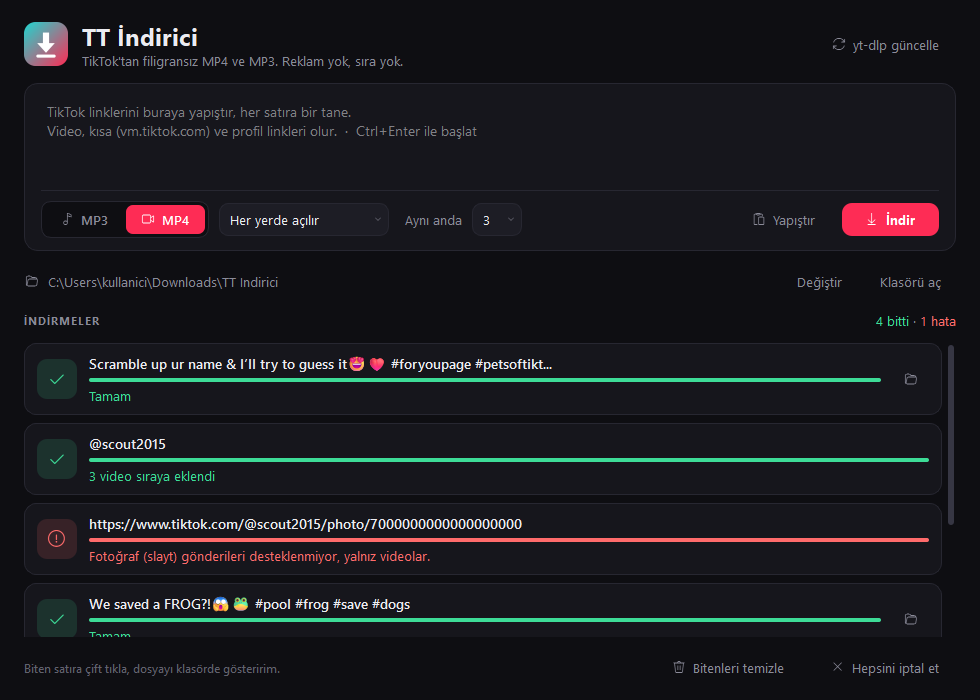

# TT İndirici

TikTok'tan doğrudan **filigransız MP4** ve **MP3** indiren, Windows için sade bir masaüstü uygulaması.

Web indiriciler videoyu önce kendi sunucularına çeker, sonra sana gönderir. TT İndirici dosyayı TikTok'tan
doğrudan indirir, MP3'e çevirme işini de senin bilgisayarında ffmpeg yapar. Reklam, sıra ve ikinci indirme yok.

## Özellikler
- Filigransız video (TikTok logosu ve kullanıcı adı yazısı olmadan)
- Birden çok link aynı anda; kısa linkler (`vm.tiktok.com`, `vt.tiktok.com`) çalışır
- Profil, etiket (`/tag/`) ve müzik (`/music/`) linkleri tek tek videolara açılır
- Aynı anda 1–6 indirme
- MP4 iki seçenekle:
  - **Her yerde açılır:** H.264, her oynatıcıda, telefonda ve düzenleme programında açılır
  - **En yüksek çözünürlük:** TikTok yüksek çözünürlüğü çoğu zaman yalnız H.265 olarak veriyor; Windows'ta
    oynatmak için Microsoft Store'daki HEVC eklentisi gerekebilir
- MP3: 320 / 256 / 192 / 128 kbps, videoda duyduğun ses; kapak resmi ve etiketler dosyaya gömülür
- İptal, kaldığı yerden yeniden deneme, `yt-dlp güncelle` düğmesi

Desteklenmeyen: fotoğraf (slayt) gönderileri, gizli hesaplar.

## Kurulum ve kullanım
1. **[TT-Indirici.zip indir](../../releases/latest/download/TT-Indirici.zip)** (her zaman son sürüm) ve zip'i bir klasöre aç.
2. `Baslat.bat`'a çift tıkla.

İlk açılışta eksikleri kendisi kurar (bir kere, birkaç dakika):
- **Python 3.12** yoksa python.org'dan indirir (SHA-256 doğrulamalı, yönetici izni gerekmez)
- **ffmpeg** yoksa uygulama klasörüne `ffmpeg\bin` olarak indirir (SHA-256 doğrulamalı)
- `.venv` sanal ortamını ve paketleri (`requirements.txt`) kurar

Sonraki açılışlar anında olur. Linkleri kutuya yapıştır, MP4 ya da MP3 seç, **İndir**'e bas (ya da Ctrl+Enter).
Dosyalar varsayılan olarak `İndirilenler\TT Indirici` klasörüne `kullanıcı - açıklama [id].mp4` adıyla iner.

## Sorun giderme
- **İndirme birden bozulduysa:** TikTok bir şeyi değiştirmiş olabilir, sağ üstteki **yt-dlp güncelle**'ye bas.
- **Uygulama açılmıyorsa:** klasördeki `hata.log`'a bak. `.venv` klasörünü silip `Baslat.bat`'ı yeniden çalıştırmak kurulumu sıfırlar.
- **Başka bilgisayara taşırken** `.venv` klasörünü kopyalama; başlatıcı onu her bilgisayarda kendisi kurar.

## Geliştirici notları
- TikTok, gerçek tarayıcı gibi görünmeyen isteğe cevap vermiyor. Bu yüzden yt-dlp `curl_cffi` ile Chrome taklidi yapıyor
  (`yt-dlp[default,curl-cffi]`).
- `TTI_DRYRUN=1` kurulumu yapar, uygulamayı açmaz
- `TTI_TEST_NOFFMPEG=1` sistemdeki ffmpeg'i yok sayar (indirme yolunu test eder)

## Yasal not
Bu araç yalnız kişisel kullanım içindir. İndirdiğin içeriğin telif haklarına ve TikTok Hizmet Şartları'na uymak
senin sorumluluğundadır. TT İndirici TikTok ya da ByteDance ile bağlantılı değildir.

## Lisans ve teşekkür
Kod [MIT](LICENSE) lisanslıdır. Kullandığı kütüphaneler kendi lisanslarıyla gelir:
[yt-dlp](https://github.com/yt-dlp/yt-dlp) (Unlicense), [curl_cffi](https://github.com/lexiforest/curl_cffi) (MIT),
[PyQt6](https://www.riverbankcomputing.com/software/pyqt/) (GPL v3),
[FFmpeg](https://ffmpeg.org/) (GPL; [gyan.dev](https://www.gyan.dev/ffmpeg/builds/) derlemesi).
